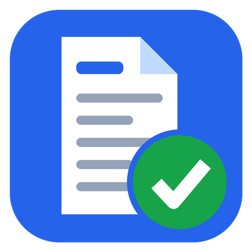

# PageProof

A browser extension for **Chrome and Firefox** that captures a whole web page, top to bottom, in one picture, and shows the hidden data inside pictures (camera, date, place, author, copyright).

**Every feature and improvement, in one list:** see [FEATURES.md](FEATURES.md).

- **Whole page:** scrolls the page for you and stitches it into one tall image. Images, embeds and videos are captured exactly as they look on screen (videos as a still frame).
- **Proof of where it came from:** a banner across the top shows the website's domain, the full web address, and the date and time of the capture.
- **Hidden content too:** anything that doesn't fit on screen is marked "Section 1", "Section 2" and so on in the capture and shown in full underneath:
  - boxes that scroll up and down on their own (like the comments on an Instagram post, chat panes, long tables)
  - **dropdown lists**: every choice is written out, with the selected one marked
- **Reels, Shorts and TikToks:** on Instagram and Facebook Reels, YouTube Shorts and TikTok, only the video on screen is captured (no scrolling into the next ones), and a shortened description is opened first so the full text shows. Anything PageProof did to the page is written in the pack under "How the capture was taken".
- **Endless pages:** on sites that keep loading more articles as you scroll, the capture stops where the page ended when you clicked. To stop a capture early, click the PageProof icon and choose **Stop and keep what's captured**.
- **Two ways to save:** PDF, and an HTML backup that stores every picture, style and font inside the file, so it still opens correctly even if the website deletes them.
- **Evidence pack:** one .zip holding everything below, named `CaseID_domain_date_time_CaptureID.zip` (for example `CASE-42_traded.co_2026-11-04_15-17-55_PP-7KQ2MX.zip`). Every capture gets its own unique Capture ID, which also appears in the PDF banner, the details file and the capture log.
  - The PDF and the HTML backup
  - `_source.html`: the page source exactly as the website's server sent it
  - `images/`: the original image files from the page
  - `image-data.txt`: the hidden data found inside each of those pictures (camera, date, place, editing software, author, copyright). The PDF gets an extra last page listing the pictures that still have hidden data.
  - `fingerprints.sha256`: a SHA-256 fingerprint for every file
  - `timestamps/`: **trusted timestamp** receipts from DigiCert, Sectigo and FreeTSA. Each free service separately signs the fingerprint list with its own clock. Only the fingerprint code is sent, never your files. Nobody needs to store anything: the receipts in your zip are the proof.
  - `README.txt`: a plain-language guide explaining every file and how anyone (like a lawyer or court) can check nothing was changed
  - `VERIFY-THIS-PACK.html`: a built-in checker anyone can double-click to check the pack, with no PageProof or internet needed
  - `capture-details.txt`: web address, page title, time and time zone, window size, browser, your name, case number and notes, and the website server's IP address, clock time and response headers
- **Who hosts this site:** each capture looks up the public registration records for the site: the hosting company and the domain registrar. It's shown on the capture page, written in `capture-details.txt`, and the full records are saved in `lookups/`.
- **Find copies (new in 4.0):** connect the shared Google Drive once and PageProof searches your clients' photos on Google Lens, Yandex and Bing all day, one at a time (**Keep searching**), or 50 at once (**Today's 50**). Every copy found is in **All copies found**, with the copyright registration number, the Drive path, the site's owner, and one-click answers (Stolen, Licensed, Remove, Skip) that can all be undone. Save a one-page **evidence report** PDF per copy. See section 17 of the [tutorial](TUTORIAL.md).
- **Side panel:** keep PageProof open beside any website (click the icon › **Keep it open beside this page**).
- **Verify a pack:** drop any evidence pack on this page and it checks every fingerprint and timestamp, then shows a clear green or red result.
- **Copy and Markup:** **Copy** puts the whole capture on your clipboard to paste anywhere. **Markup** lets you highlight, draw boxes, circles and arrows, or type on a copy of a capture, then copy it to paste into an email or chat, or download it as a picture or PDF. You can pick just part of the page. The copy gets a "Marked-up copy" label and is never added to the evidence pack, so the original stays untouched.
- **Image Inspector:** click the PageProof icon, then **Inspect a picture**. Pick a picture by pointing at it on the page (like uBlock's element picker), choose from **all the pictures on the page** (each marked if it still has hidden data), upload one from your computer, or right-click any picture and choose **PageProof ▸ Inspect picture**. PageProof downloads the original file (the biggest version the site offers), then shows a plain-English summary ("Taken on a Canon EOS R6 on 3 Jun 2025 by J. Rivera..."), the camera, date, GPS place, editing software, author and copyright, plus folded lists of every EXIF, IPTC and XMP field, the edit history and Content Credentials (C2PA, including signs of AI). A yellow warning shows when the data has been stripped. Save a **PDF report** or an **evidence pack** (the untouched original file, the PDF, the data as text, fingerprints, trusted timestamps, README and the offline checker).
- **Right-click menu:** right-click anywhere on a website and point at **PageProof** for **Inspect this photo**, **Find copies of it** (Google Lens, Yandex, Bing or all three), **Save biggest copy…**, **Save as Breaking News photo…** (named the firm's way and checked against the photographer's photos for New or Recycled), **Open biggest copy in a tab**, **Capture this page**, and on links **Capture the linked page**. It also finds pictures that sites like Instagram and Facebook hide under an invisible cover, so you don't have to dig through the browser's Inspect tool.
- **Compare two pictures:** like superimposing in Photoshop. Put your client's original in box 1 and the copy in box 2. **Line them up automatically** resizes and moves the copy onto the original by matching the same details in both (it handles resized, zoomed-in, cropped, stretched, tilted and mirrored copies, and copies with headlines or logos printed over them; **Size and shape** sliders let you adjust by hand) and says how much of the shared area lines up. It also tells a different photo of the same place from a real copy: when only logos, signs or lettering line up (a sponsor wall, a shop sign) it says **Different photo, only the logos match**, and when the scene lines up but things at different distances shift against each other (a building shot from a few steps away) it says **Different photo of the same place**. A seal on a podium or a crest on the wall that is the only thing lining up gives **Different photo, only a seal or emblem matches**, a chain-link fence or checkered floor gives **Different photo, only a pattern matches**, and when only a small slice of each picture is shared it says **Different photo, only a small part matches**. Then fade between them with the slider, **Slide aside and back**, drag or nudge with the arrow keys, or switch to the **Difference** view (black where they match). Save it as a PDF (both pictures, the overlay at 0%, 50% and 100%, and the difference view), a picture, or a short video. Open it from the Image Inspector (**Compare with the original**) or the PageProof icon menu.
- **Convert files:** change picture types (JPG, PNG, WebP, GIF, BMP, PDF, from any of those plus iPhone HEIC, TIFF and AVIF), make pictures and PDFs smaller to fit an email or court upload limit, rotate, crop or resize pictures (one or all at once), join PDFs and pictures into one PDF (tick boxes and ▲ ▼ to set the order), split or pick PDF pages, and save Word, Excel, RTF, OpenOffice, text and email files as PDF. Several results can be saved as separate files or one ZIP. Everything runs on your computer; nothing is uploaded.
- **Open odd files:** look inside Outlook .msg and .eml emails (and save their attachments), ZIP, RAR, 7-Zip and TAR archives, Mac Pages, Numbers and Keynote files, and HEIC or TIFF pictures, then save them as PDF or pull files out.
- **Before you mark Stolen:** the copy details show a rule check by kind of site, the photo credit and signs it was on purpose read from their page, the date first published, a damages hint and a Ready for legal checklist. See section 19 of the [tutorial](TUTORIAL.md).
- **Capture log:** a running list of every capture and every evidence pack saved (with the pack's own fingerprint). Open it from the left bar on the capture page, and download it as a spreadsheet (.csv).

## How to use it

1. Go to any normal website.
2. Click the PageProof icon in your toolbar, then the big green **Capture this page** (or press **Alt+Shift+P** to capture straight away, without the menu).
3. It jumps to the top of the page, then scrolls down while it captures. The icon shows a counter while it works. Don't scroll or switch tabs until it finishes. To stop early, click the icon and choose **Stop and keep what's captured**.
4. A new tab opens with your capture. Fill in **Collected by**, **Case / reference number** and any **Notes** (your name is remembered; the case number and notes start empty each time).
5. Then click the green **⬇ Save evidence pack** to get everything at once, or click **PDF** or **HTML** to download one file on its own.

**Reverse image search (many pictures at once):** open the full PageProof page, choose **Find copies › New search**, add your pictures and press **Search**. Each picture is searched on Google Lens, Yandex and Bing in its own tab group, and every link found is listed with a % match. Hide sites you never care about; the list is saved in `Documents\PageProof`. See section 16 of the [tutorial](TUTORIAL.md).

## Checking a pack

Open **Verify a pack** in PageProof and drop the zip on it. To check without PageProof, see **[VERIFYING.md](VERIFYING.md)**.

For a step-by-step guide to using PageProof day to day, see **[TUTORIAL.md](TUTORIAL.md)**.

## Install it

### Step 1: Download

1. Open the [Latest build](https://github.com/TheBenPsych/PageProof/releases/tag/latest) page.
2. Click **PageProof.zip** to download it.
3. Unzip it into **Documents › PageProof › Install**: on Windows, right-click the file, choose **Extract All**, press **Browse**, go to Documents, make a folder called **PageProof** (if it isn't there yet), open it, make a folder called **Install** inside it, pick that, and press **Extract**. On a Mac, double-click it and move the folder to the same place.

One folder holds everything: **Documents › PageProof** keeps your saved work (copies found, settings, site lists), and the **Install** folder inside it holds the program. PageProof never writes anything inside **Install**, so updates and virus checkers leave your work alone.

### Step 2a: Chrome (also works for Edge and Brave)

1. Type `chrome://extensions` in the address bar and press Enter.
2. Turn on **Developer mode** (the switch in the top-right corner).
3. Click **Load unpacked** and choose **Documents › PageProof › Install** (the folder with `manifest.json` in it).
4. Click the puzzle-piece icon in the toolbar, then the pin next to PageProof so its icon is always visible.

Chrome keeps it installed after a restart. To update later, download the new zip, unzip it into the same **Install** folder (say yes to replacing the files), and click the circular arrow on PageProof's card in `chrome://extensions`. **Quicker (Windows):** download [Update-PageProof.cmd](https://github.com/TheBenPsych/PageProof/releases/download/latest/Update-PageProof.cmd) once, keep it in Documents › PageProof, and double-click it whenever you want the newest version, then click that arrow (see [tools/windows](tools/windows/README.md)). It also does a first install.

### Step 2b: Firefox

Firefox needs its own download: **PageProof-Firefox.zip** from the [Latest build](https://github.com/TheBenPsych/PageProof/releases/tag/latest) page. Unzip it first.

1. Type `about:debugging#/runtime/this-firefox` in the address bar and press Enter.
2. Click **Load Temporary Add-on...**
3. Open the unzipped **PageProof-Firefox** folder and choose the file **manifest.json**.

Firefox removes "temporary" add-ons when it closes, so you'd repeat these steps after a restart. To install it permanently, it has to be signed by Mozilla (free). That's a planned next step.

## Good to know

- PageProof keeps the same extension ID wherever its folder is (it is fixed in `manifest.json`), so moving the **Install** folder and loading it again does not lose what PageProof stored in the browser. To move it, don't press Remove (that deletes its stored data): move the folder, then **Load unpacked** the new spot and it takes the old one's place.

- Browser pages like the new tab page, settings, and the add-on stores can't be captured. Browsers block that for safety.
- Sites that scroll inside a big box instead of the whole window (many web apps) are captured as one normal page, not as a separate section.
- Sticky headers and menus appear once at the top instead of repeating down the page.
- Very long pages stop after 60 screens.
- Carousels, fold-out areas and hover menus aren't opened automatically. Open them to what you need yourself, then press **Alt+Shift+P**.
- The PDF is always one file, however long the page.
- PageProof asks to "access data on all websites" so it can save the page's pictures, ask the server for its details, and get the timestamp. It only does this when you click capture. Besides the fingerprint code (to the timestamp services), the site's domain and server address are looked up in public registration records (rdap.org).
- Your capture log lives in this browser. Download it as a .csv now and then to keep a copy.
- Keep your evidence zips unchanged, ideally with a copy on a separate drive. Opening them is fine, but re-saving or editing a file breaks its fingerprint.
- Convert files uses a few free helper libraries, kept in `extension/lib/` (see `extension/lib/LICENSES.txt`). They are loaded only when needed and run entirely inside the browser.
- Videos are saved as the frame showing on screen (and their cover picture in the HTML backup), not the video file itself.
- Content inside an embedded frame from another site (like a YouTube player) is captured as it looks, but scroll boxes inside such frames aren't expanded.

## Making changes

See [CONTRIBUTING.md](CONTRIBUTING.md): no version bumps in pull requests, one note per change in `changes/`, and the download is rebuilt about a minute after each merge.
